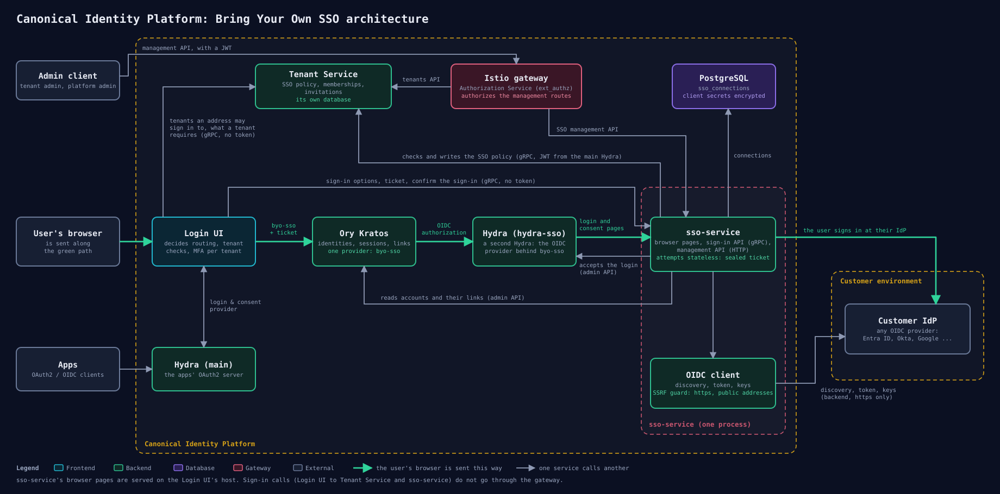

# SSO Service

The SSO Service lets a tenant of the Identity Platform sign its members in with its own OpenID Connect
identity provider. It keeps the connections tenants register, signs people in through them as the login
and consent provider of `hydra-sso`, and manages each tenant's SSO policy.

## Architecture



Kratos keeps one OIDC provider, `byo-sso`, for every tenant's identity provider. That provider is a second
Hydra, `hydra-sso`, and this service is its login and consent provider: it sends the browser to the tenant's
identity provider, checks the answer against the tenant's SSO policy, and accepts the login.

- The Login UI calls the service's sign-in API for the sign-in options and a ticket, and to confirm the
  sign-in afterwards.
- A tenant's SSO policy is stored by the Tenant Service. The service checks and writes it there.
- The management API is served through the gateway, where the Authorization Service authorizes each route.
- The connections tenants register are rows in the service's PostgreSQL database. The service uses no
  message broker and publishes no permission events.

## Getting Started

To build the service, run:

```bash
make build
```

This produces the `app` binary. The service needs PostgreSQL, Kratos, the Tenant Service and two Hydras:
the one that issues the access tokens its callers send, and `hydra-sso`, whose login and consent provider
it is.

Apply the database migrations before the first start, and after an upgrade:

```bash
./app migrate --dsn <dsn> up
```

Then start the service:

```bash
./app serve
```

`serve` refuses to start while a migration is pending.

## Tests

To run the unit tests:

```bash
make test-unit
```

To run the unit and the integration tests:

```bash
make test
```

The integration tests are the `*_integration_test.go` files next to the code they exercise. They start
the containers they need (PostgreSQL, and Hydra for the authentication test) through
`internal/testhelpers`, so a container runtime must be available. Kratos, `hydra-sso` and the Tenant
Service are replaced by fakes in them; exercising the service against the real ones needs a deployment
of the platform.

## Configuration

The service is configured using environment variables.

| Variable | Description | Default | Required |
| :--- | :--- | :--- | :--- |
| `OTEL_GRPC_ENDPOINT` | OpenTelemetry gRPC Collector Endpoint | | No |
| `OTEL_HTTP_ENDPOINT` | OpenTelemetry HTTP Collector Endpoint | | No |
| `TRACING_ENABLED` | Enable OpenTelemetry Tracing. When the exporter cannot be created, the service logs the error and runs without tracing | `true` | No |
| `LOG_LEVEL` | Logging Level | `error` | No |
| `DEV` | Allow identity providers over plain http and at private addresses, and a `PUBLIC_URL` over plain http. Never in production | `false` | No |
| `PUBLIC_URL` | URL browsers reach the service at: `https`, with no query and no fragment, on the host that serves the login UI, which reads a cookie the service sets when it accepts a sign-in. A connection's redirect URI is `<PUBLIC_URL>/callback/<connection id>` | | Yes |
| `PORT` | HTTP Server Port | `8080` | No |
| `GRPC_PORT` | gRPC Server Port | `50051` | No |
| `DSN` | PostgreSQL Connection String | | Yes |
| `DB_MAX_CONNS` | Maximum open DB connections | `10` | No |
| `DB_MIN_CONNS` | Minimum open DB connections | `1` | No |
| `DB_MAX_CONN_LIFETIME` | Maximum amount of time a connection may be reused | `1h` | No |
| `DB_MAX_CONN_IDLE_TIME` | Maximum amount of time a connection may be idle | `30m` | No |
| `HYDRA_SSO_ADMIN_URL` | Admin API URL of `hydra-sso` | | Yes |
| `KRATOS_ADMIN_URL` | Ory Kratos Admin API URL | | Yes |
| `TENANT_SERVICE_GRPC_ADDRESS` | Tenant Service gRPC address | | Yes |
| `TENANT_SERVICE_GRPC_TIMEOUT` | Maximum amount of time a call to the Tenant Service may take | `5s` | No |
| `TENANT_SERVICE_TLS_ENABLED` | Use TLS for the connection to the Tenant Service | `false` | No |
| `AUTHENTICATION_ENABLED` | Enable JWT Authentication | `true` | No |
| `AUTHENTICATION_ISSUER` | OIDC Issuer URL for JWT validation | | Yes (if auth enabled) |
| `AUTHENTICATION_JWKS_URL` | JWKS URL (optional, overrides discovery) | | No |
| `AUTHENTICATION_ALLOWED_SUBJECTS` | Comma-separated list of allowed subjects | | No |
| `AUTHENTICATION_REQUIRED_SCOPE` | Required scope for access | | No |
| `SERVICE_TOKEN_URL` | Token endpoint the service gets its own access token from | | Yes |
| `SERVICE_CLIENT_ID` | Client ID of the service | | Yes |
| `SERVICE_CLIENT_SECRET` | Client secret of the service | | Yes |
| `SERVICE_TOKEN_SCOPES` | Space-separated scopes to request for the service's own access token | | No |
| `ENVELOPE_KEY` | The key that encrypts client secrets and seals what a sign-in carries: 32 bytes in base64 | | Yes |

## Authentication

Every route under `/api/v0/sso` and every gRPC call of the two management services needs a JWT
access token issued by `AUTHENTICATION_ISSUER`, sent as `Authorization: Bearer <token>`. With neither
`AUTHENTICATION_ALLOWED_SUBJECTS` nor `AUTHENTICATION_REQUIRED_SCOPE` set, any valid token with a
subject is accepted; with one of them set, the token's subject must be listed or the token must carry
the scope. The service authenticates its callers and authorizes none: the gateway in front of it does.

The browser pages (`/login`, `/callback/{connection_id}`, `/consent`, `/error`) are not authenticated.
Neither is `SSOSignInService`, which has no HTTP route: the login UI calls it on the gRPC listener,
which must be reachable from the internal network only.

With `AUTHENTICATION_ENABLED=false` no token is verified: a bearer token is still required, and its
value is taken as the caller's id. Use it in development only.

## Management commands

The binary is also a client of its own management API, for use until there is a console and by the
charm's actions. Each command calls a running service on its gRPC listener and prints the API's
response as JSON:

```shell
sso-service connection list [tenant-id]          # every tenant's when no tenant is given
sso-service connection get <tenant-id> <connection-id>
sso-service connection create <tenant-id> --label <label> --issuer <url> --client-id <id>
sso-service connection update <tenant-id> <connection-id> [--label <label>]
sso-service connection delete <connection-id>
sso-service connection test <tenant-id> <connection-id>   # prints the URL to open in a browser
sso-service policy get <tenant-id>
sso-service policy set <tenant-id> --enforcement optional|required [--binding <connection-id>[:inactive]]... [--auto-join]
sso-service domains get <tenant-id>
sso-service domains set <tenant-id> [domain...]
```

`--grpc-endpoint` (default `localhost:50051`) is the service's address and `--token` the caller's
access token (see [Authentication](#authentication)). `connection create` and `connection update`
take the client secret from `--client-secret` or, when the flag is not set, from the `CLIENT_SECRET`
environment variable, which keeps it out of the command's arguments.

## Errors

An HTTP error is `{"status": <HTTP status>, "message": "<text>"}`. An error callers branch on starts
its message with a reason, as in `CONNECTION_NOT_FOUND: no such connection`; over gRPC the reason is
also a `google.rpc.ErrorInfo` detail of the status (domain `sso-service`).

## Database

Every database connection is opened with a `lock_timeout` of 2s, a `statement_timeout` of 5s and an
`idle_in_transaction_session_timeout` of 15s, and a transaction lasts 10s at most. `migrate` waits 3s
for a lock and fails then, so that a migration never holds other statements up behind it.
